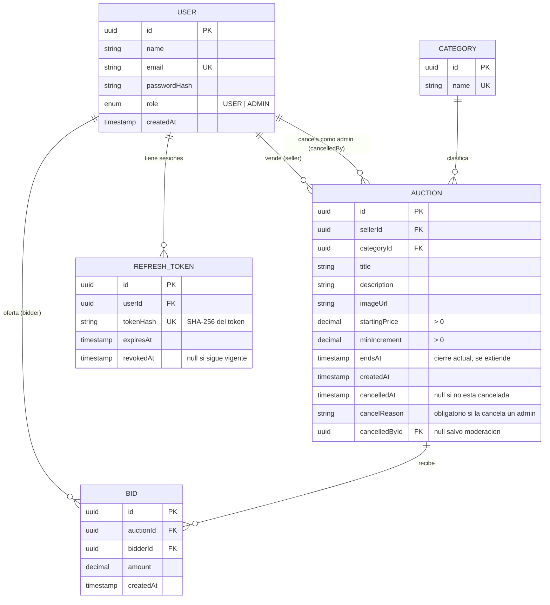

# DER de BidHub

Modelo relacional (PostgreSQL). Cinco entidades, por eso el flujo de trabajo
exige DER completo antes de escribir código que toque la base de datos.

## Diagrama

## Relaciones

| Relación | Cardinalidad | Regla que respalda |
|---|---|---|
| User → Auction (vendedor) | 1 a N | 4, 5, 14, 19 |
| User → Bid (postor) | 1 a N | 6, 9, 20 |
| Category → Auction | 1 a N | 3, 17 (`onDelete: Restrict`) |
| Auction → Bid | 1 a N | 8, 10, 11, 18 |
| User → RefreshToken | 1 a N | T9 (revocación en logout) |
| User → Auction (cancelador) | 1 a N opcional | 15 (quién moderó) |

## Decisiones del modelo

- **El estado de la subasta no es una columna.** Se deriva siempre con una sola
  función (`getAuctionStatus`): `cancelledAt` presente → CANCELLED; si no,
  `now < endsAt` → ACTIVE; si no, con ofertas → CLOSED, sin ofertas → DESERTED.
  Así se cumple la regla 13 sin cron ni procesos externos.
- **`endsAt` es el cierre vigente.** Se mueve hacia adelante cuando una oferta
  llega en los últimos 5 minutos (regla 11).
- **Dinero en `Decimal(12, 2)`**, nunca `Float`, para no tener errores de redondeo.
- **Las ofertas son inmutables** (regla 10): no hay endpoints ni métodos de
  servicio para editarlas o borrarlas.
- **Las subastas nunca se borran** (regla 16): no existe `DELETE` de subastas;
  la cancelación es lógica con `cancelledAt`.
- **Categoría con subastas no se elimina** (regla 17): `onDelete: Restrict` en
  la base de datos y verificación en el servicio para dar un 409 claro.
- **El refresh token se guarda como hash SHA-256**, no con bcrypt: es un valor
  aleatorio de alta entropía, y necesitamos buscarlo por hash.
- **Índices:** `Auction(endsAt)`, `Auction(sellerId)`, `Auction(categoryId)`,
  `Bid(auctionId, amount)` para obtener rápido la oferta más alta.
